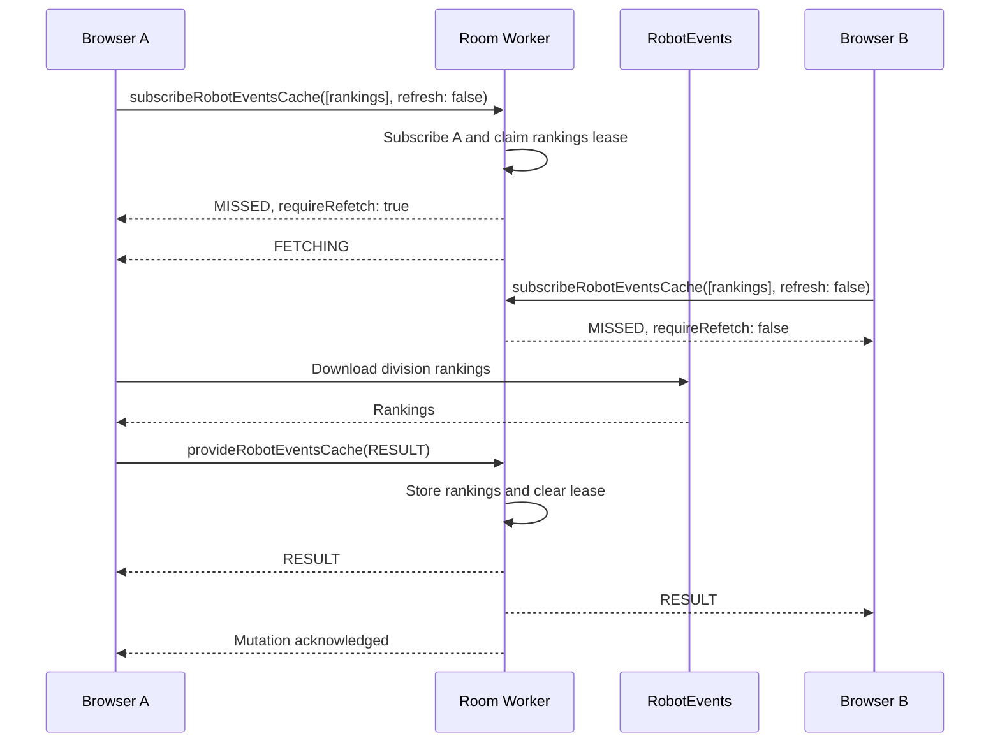
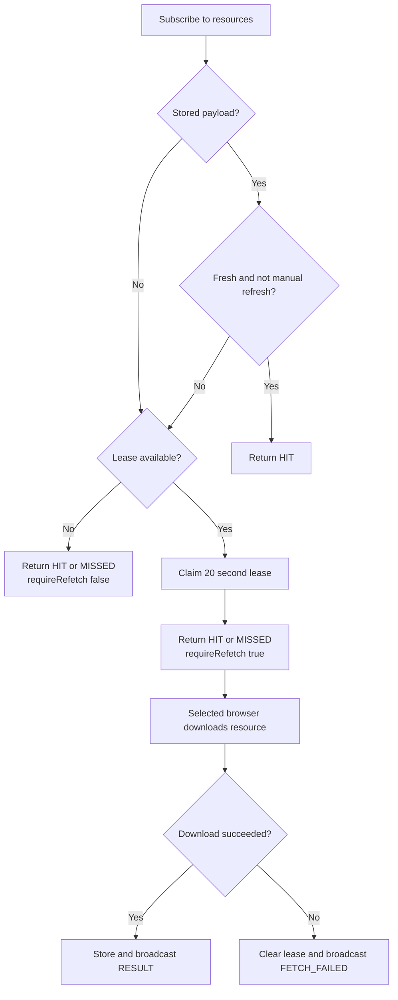

# RobotEvents caching

## Why the cache exists

Several judges can open Team Attendance, Excellence Award Candidates, or Final Ranking at nearly the same time. If every browser downloads the same RobotEvents lists, the shared API token and venue IP can quickly receive `Too Many Requests` responses.

The Judges' Room Worker should coordinate those browsers, but it should not download RobotEvents data itself. Cloudflare egress addresses are shared and are more likely to encounter IP-based rate limits. Instead:

1. Browsers ask the room for cached lists.
2. The room selects one browser to download each missing or stale list.
3. That browser calls RobotEvents directly.
4. It returns the result to the room.
5. The room stores and broadcasts the result to other subscribed browsers.

The result is a per-room, stale-while-revalidate cache with a short fetch lease.

## Cache resources

The cache stores independently reusable RobotEvents lists:

| Resource | Scope | Used by |
| --- | --- | --- |
| `teams` | All teams registered for the event, including grade | Excellence Award Candidates and Final Ranking |
| `rankings` | Qualification rankings for the room's division | Team Attendance, Excellence Award Candidates, and Final Ranking |
| `skills` | Skills results for all divisions at the event | Excellence Award Candidates and Final Ranking |

Team Attendance requests only `rankings`. Excellence features request all three resources. If Attendance has already populated `rankings`, Excellence downloads only the missing `teams` and `skills` lists.

## Storage

Each room's Durable Object stores up to one row per resource in `RobotEventsCache`:

| Column | Meaning |
| --- | --- |
| `resource` | Primary key: `teams`, `rankings`, or `skills` |
| `payload` | The last validated JSON list, or `NULL` before the first result |
| `fetchedAt` | Time the browser fetched the stored result, or `NULL` before the first result |
| `fetchingStarted` | Start time of the active lease, or `0` when idle |

`payload` and `fetchedAt` are nullable because a row is created as soon as a browser takes a lease. At that point a download is in progress, but no result exists yet.

The cache is inside the room Durable Object, so separate Judges' Rooms do not share results. Two rooms running the same event can each perform one fetch.

## Freshness and leases

- A cached resource is fresh for 60 seconds.
- An ordinary tab open reuses a fresh resource.
- A manual refresh ignores freshness and requests a new result if the lease is available.
- A fetch lease lasts 20 seconds.
- While a lease is active, other browsers keep the current stale value, if one exists, and wait for a broadcast.
- If the original browser never reports a result, the lease is considered expired after 20 seconds. The next subscribe or refresh request may take it.

Lease ownership is represented by the database row. Broadcasts communicate state to the UI; they are not the synchronization primitive.

## Normal request flow



Only the browser that receives `requireRefetch: true` calls RobotEvents. Other browsers wait for `RESULT` or `FETCH_FAILED`.

## Stale-while-revalidate

When a stored resource is stale, the Worker returns it as a `HIT` and may also set `requireRefetch: true`. The selected browser can continue displaying the stale list while it downloads a replacement.



Manual refresh follows the same flow, except it treats a fresh result as stale. If another browser is already downloading that resource, the refresh waits for the shared result.

## Protocol

### Subscribe

`subscribeRobotEventsCache` is a mutation because the request both subscribes the browser and may atomically claim one or more leases.

Input:

- `resources`: one or more of `teams`, `rankings`, and `skills`
- `refresh`: whether to bypass the 60-second freshness window

The response contains one status per resource:

- `state`: `HIT` or `MISSED`
- `payload` and `fetchedAt` when a valid stored result exists
- `fetchingStarted` when a lease is active
- `requireRefetch`: whether this browser owns the new lease and must call RobotEvents

### Provide

`provideRobotEventsCache` accepts:

- `RESULT`, with `fetchedAt` and one or more downloaded resource lists
- `FETCH_FAILED`, with the resources whose leases should be cleared

It is a mutation rather than a notification so the fetching browser receives an acknowledgement that the room stored the result or cleared the lease. The browser updates its own local state only after that acknowledgement. If the mutation fails, the browser reports failure instead of assuming that other clients received the data.

An incoming result older than the stored `fetchedAt` is ignored, preventing a delayed browser from replacing newer data.

### Broadcasts

Each resource has its own topic:

```text
robotEventsCache:teams
robotEventsCache:rankings
robotEventsCache:skills
```

Subscribers can receive:

- `FETCHING`: a browser has taken the lease; stale payload may be included
- `RESULT`: a new payload was stored
- `FETCH_FAILED`: the fetch failed and the lease was cleared

The Worker commits database changes before broadcasting. It starts client notifications without waiting for every recipient to process them.

## Client behavior

`RobotEventsCacheStore` keeps one reactive slot per resource. Tabs retain the resources they need while active and unsubscribe when no active holder remains.

When the store owns a lease, it downloads resources sequentially in this order:

1. `teams`
2. `rankings`
3. `skills`

Sequential downloads reduce request bursts against RobotEvents. Successfully downloaded lists can still be provided if a later list fails. The remaining resource leases are then cleared with `FETCH_FAILED`.

The singleton store also deduplicates overlapping requests in the same browser. For example, if Attendance and Excellence become active together, their common `rankings` request is not downloaded twice by that browser.

## Validation and trust

The protocol validates every list with Zod before it is stored or applied by a client. This validates shape, not provenance. The room trusts the selected browser to provide the RobotEvents response and does not re-download the data to verify it.

This is an intentional trade-off: preventing API request bursts is more important here than defending against a malicious room participant.

## Current limitations

- The cache is per room, not shared between rooms or events at the same venue.
- Rows are keyed only by resource. The design assumes a room remains configured for the same RobotEvents event and division. Changing the event or division should invalidate the rows or extend the key with event and division identifiers.
- Lease expiry is passive. No timer elects another fetcher automatically; a later subscribe or refresh request observes the expired lease and takes it.
- A `FETCH_FAILED` broadcast does not trigger every waiting browser to retry, which avoids another request stampede. A later subscribe or refresh can start the next attempt.
- API key rotation and cross-room caching remain separate future improvements.

## Main implementation files

- `protocol/src/robotevents-insight.ts`: resource types, timings, protocol schemas, and topic names
- `worker/src/db/schema.ts`: `RobotEventsCache` table
- `worker/src/routes/robotevents.ts`: subscriptions, lease decisions, persistence, and broadcasts
- `web/src/lib/robot-events-cache.svelte.ts`: reactive client cache and browser fetch coordination
- `web/src/lib/robotevents-source.ts`: direct RobotEvents downloads and Excellence report reconstruction
- `worker/src/routes/robotevents.spec.ts`: lease, refresh, sharing, expiry, ordering, and failure tests
